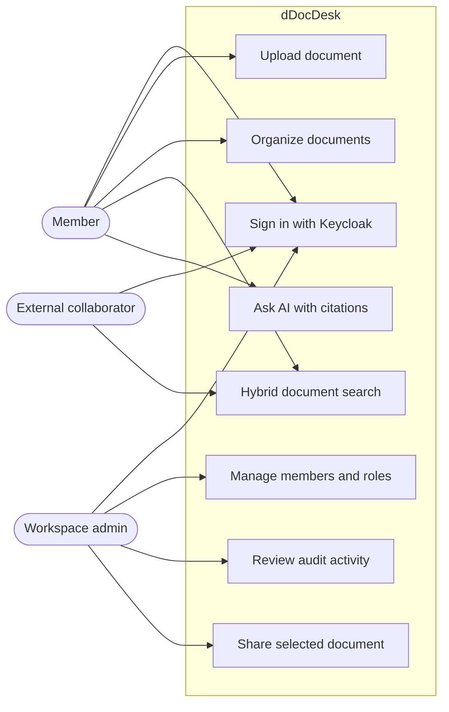
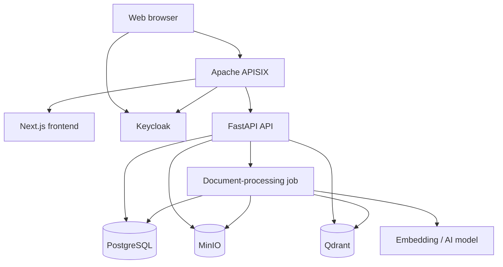
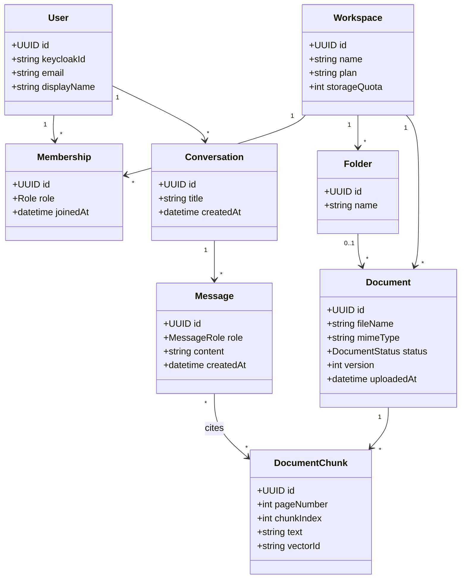
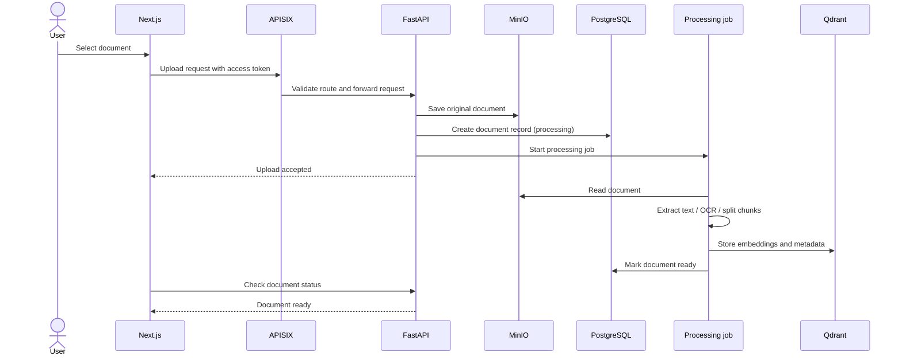
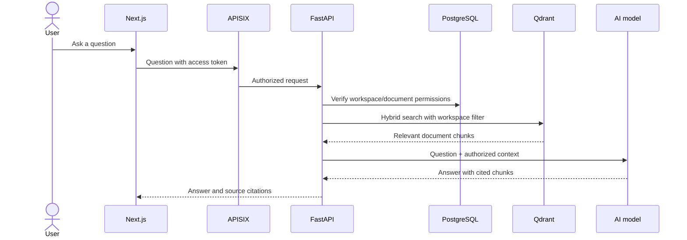

## Build plan: dDocDesk small MVP

**Goal:** a self-hosted document workspace where a small team can sign in, upload files, search them, and ask AI questions with source citations.

**Included:** Keycloak login, workspaces/roles, PDF/DOCX/TXT upload, MinIO storage, extraction/OCR, Qdrant hybrid search, cited AI chat, Kubernetes deployment.

**Deferred:** billing, external sharing, SSO/SCIM, high availability, multi-region, advanced collaboration, full monitoring suite.

### Phase 1 — Foundation (week 1)

- Create frontend, API, worker, and Kubernetes folder structure.
- Configure local K3s deployment.
- Install APISIX, Keycloak, PostgreSQL, MinIO, Qdrant.
- Add environment configuration, secrets, health checks, and CI checks.

**Done when:** one command deploys the platform and each service reports healthy.

### Phase 2 — Identity and workspaces (week 2)

- Configure Keycloak realm, client, roles, and token claims.
- Build sign-in/sign-out flow.
- Create workspace, membership, and role models.
- Enforce authorization in FastAPI for every protected endpoint.

**Done when:** an admin can create a workspace, invite a member, and members cannot access another workspace’s data.

### Phase 3 — Document library (weeks 3–4)

- Build upload, list, metadata, folder, delete, and download APIs.
- Store original documents in MinIO.
- Create document-processing Kubernetes Jobs.
- Extract text from PDF, DOCX, and TXT; add OCR for scanned PDFs.
- Show processing status and document preview in the web app.

**Done when:** a user can upload a document and see it become searchable after processing.

### Phase 4 — Search (week 5)

- Split extracted content into chunks.
- Generate local embeddings.
- Store vectors and permission-aware metadata in Qdrant.
- Implement keyword + semantic hybrid search.
- Display snippets, document names, and page references.

**Done when:** searches return only documents the current user may access, with relevant source excerpts.

### Phase 5 — AI document assistant (week 6)

- Connect a self-hosted model service.
- Retrieve authorized chunks from Qdrant.
- Generate answers grounded only in retrieved content.
- Return page/document citations with every answer.
- Persist conversations and messages.

**Done when:** users can ask a question and open the exact document source behind each answer.

### Phase 6 — Quality and release (weeks 7–8)

- Add unit, integration, authorization, and upload-processing tests.
- Add backup procedures for PostgreSQL, MinIO, and Qdrant.
- Add basic logs, metrics, request limits, and error handling.
- Write deployment, operation, and recovery documentation.
- Run security review: file validation, authorization boundaries, secret handling, and network rules.

**Done when:** the MVP deploys cleanly to a fresh K3s server, critical flows are tested, and recovery steps are documented.

### Proposed project structure

```text
ddocdesk/
├── frontend/
├── backend/
│   ├── app/
│   ├── workers/
│   └── tests/
├── infrastructure/
│   ├── helm/
│   ├── kubernetes/
│   └── scripts/
├── docs/
├── .env.example
├── docker-compose.yml         # optional local development
└── README.md
```

### Key implementation decisions

- **Frontend:** Next.js + TypeScript
- **Backend:** FastAPI + Python
- **Gateway:** Apache APISIX
- **Identity:** Keycloak
- **Metadata:** PostgreSQL
- **Files:** MinIO
- **Vector search:** Qdrant
- **Processing:** Kubernetes Jobs
- **AI:** self-hosted embedding and chat models
- **Deployment:** K3s initially; portable Kubernetes manifests/Helm charts for later scale

The first build target is an eight-week small MVP. Approve this scope and I’ll begin by creating the project foundation and Kubernetes deployment structure.

Important:  use the latest and stable utilites and tools.  for now, phase 1 should be the last phase and we  run apps locally and use docker for postgressql and others.


These UML diagrams describe the small dDocDesk MVP while keeping a clear path to SaaS scale.

### Use-case diagram



### Component diagram



### Core domain class diagram



### Document-upload sequence diagram



### AI question-answer sequence diagram



These five diagrams cover users, components, data, upload processing, and AI retrieval.


# For a future large-scale dDocDesk SaaS, these are the main user groups and their needs.

| User type | Core needs |
|---|---|
| Individual user | Upload, view, organize, search, summarize, and ask questions about private documents. |
| Team member | Shared folders, controlled collaboration, comments, document versions, and reliable citations in AI answers. |
| Workspace admin | Invite/remove members, manage roles, storage limits, document retention, billing, and workspace settings. |
| Organization admin | Multiple workspaces, departments, SSO, user provisioning, global policy enforcement, and usage reporting. |
| Security / IT team | SAML/OIDC SSO, SCIM provisioning, MFA, audit logs, encryption, IP restrictions, data residency, backups, and access reviews. |
| Compliance / legal team | Retention rules, legal hold, immutable audit trails, document classification, eDiscovery/export, and deletion controls. |
| External collaborator | Secure, time-limited access to specific documents or folders without seeing the full organization. |
| Developer / integrator | API keys, webhooks, SDKs, API documentation, OAuth applications, and integrations with existing systems. |
| Support operator | Tenant diagnostics, safe impersonation with audit trail, health status, usage visibility, and incident tooling. |

Future user-facing capabilities:

- Personal and team document libraries
- Folder hierarchy, tags, metadata, favorites, and saved searches
- Full-text, semantic, and hybrid search
- AI chat over selected documents with page-level citations
- AI summaries, translation, extraction, and comparison
- OCR for scans, including multilingual documents
- PDF, Word, spreadsheet, image, and presentation support
- Version history, restore, and duplicate detection
- Comments, mentions, notifications, and task assignment
- Secure external sharing with expiry, password protection, and download controls
- Custom roles and detailed document-level permissions
- Bulk upload, migration, export, and deletion
- Mobile-friendly web interface and accessibility support
- Usage dashboards and storage quotas

Large-SaaS platform requirements:

- Multi-tenancy with strict tenant isolation
- Regional deployment and data-residency choices
- High availability and disaster recovery
- Horizontal scaling for APIs, processing workers, Qdrant, and AI inference
- Reliable queues, retry handling, and dead-letter processing
- Rate limits and usage-based subscription plans
- Centralized logging, metrics, tracing, alerting, and audit events
- Backup and restore testing for PostgreSQL, MinIO, and Qdrant
- Security controls: malware scanning, file validation, encryption, secret management, network policies, and vulnerability scanning
- Enterprise authentication: Keycloak federation with SAML, OIDC, LDAP/Active Directory, and SCIM
- Public API, webhooks, connectors, and integration marketplace
- Admin and support portal separated from the customer application

A sensible growth path is:

1. **MVP:** private upload, document processing, hybrid search, cited AI chat, basic Keycloak roles.
2. **Team SaaS:** workspaces, invitations, shared folders, subscriptions, quotas, audit logs, backups.
3. **Enterprise SaaS:** SSO, SCIM, multi-region deployments, compliance controls, advanced permission models, integrations, and high availability.

